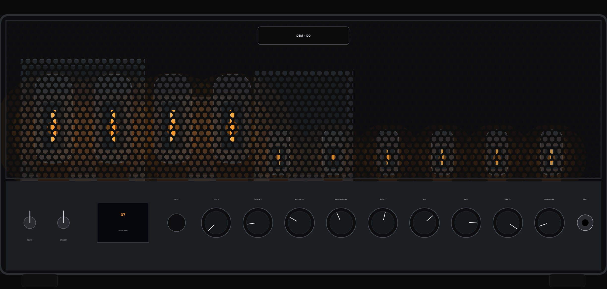
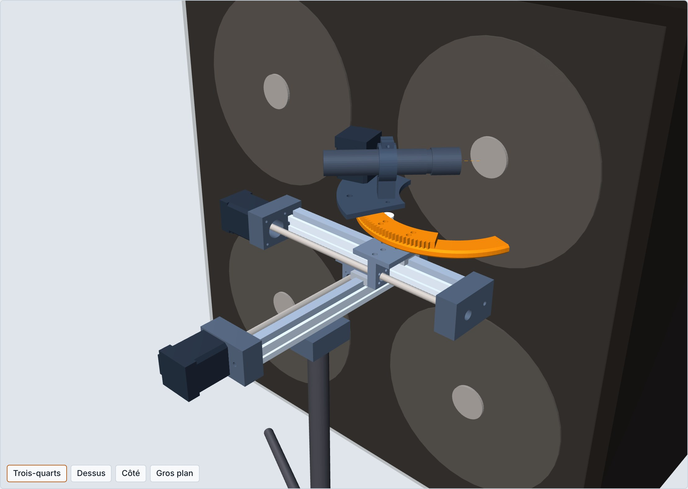

# SLO pilote

Tête guitare 100 W à lampes de la famille Soldano SLO-100, dont tous les réglages se rappellent par presets : potentiomètres motorisés qui tournent tout seuls, commutations par LDR et relais, Tube Screamer et HM-2 analogiques mélangés par VCA, noise gate analogique, et robot qui place le micro devant le baffle. Tout le signal reste analogique ; seuls les réglages sont numériques. Le son visé est le métal moderne, entre le djent serré et le « Swedish chainsaw ».

*English: a 100 W SLO-100-style tube guitar head whose knobs are motorized and recalled by presets, with an analog Tube Screamer and HM-2 clone blended by VCAs, an analog noise gate and a 3-axis microphone robot in front of the cab. Documentation is in French.*



> **Danger.** Une tête à lampes contient des tensions mortelles (B+ autour de 500 V continus, plus de 700 V alternatifs au secondaire du transformateur), qui restent dans les condensateurs après l'extinction. Ne construisez ni ne dépannez cet ampli sans savoir travailler en haute tension.

## État

Conception en cours. Rien n'est encore construit ni mesuré : tout ce qui suit est simulé ou dessiné, pas validé sur un prototype.

| Partie | Contenu | Dossier |
|---|---|---|
| Dossier de conception | choix, calculs, résultats de simulation, câblage, mise en route | [`docs/conception.md`](docs/conception.md) |
| Simulation | modèle ngspice complet (préampli, tone stack, puissance, alimentation réelle, commutations, bruit), TS808 et HM-2, premiers calculs en Python | [`spice/`](spice/), [`sim/`](sim/) |
| Schéma | KiCad 7, 8 feuilles, 560 composants, vérifié automatiquement contre le modèle SPICE | [`kicad/`](kicad/) |
| Nomenclature | 77 lignes sourcées, environ 1 900 CHF pour la tête | [`bom/`](bom/) |
| Châssis | plans PDF, DXF de découpe laser, rendus | [`mech/`](mech/) |
| Robot de micro | modèle CadQuery paramétrique, STEP et STL des pièces imprimées, contrôle d'interférence, maquette 3D | [`robot/`](robot/) |

Révision 0.2 du schéma (8 novembre 2026) : Raspberry Pi 4 comme contrôleur unique, entrée TS808 ∥ HM-2 dosée par VCA avec un bouton Blend motorisé, noise gate analogique après le préampli, plus aucun composant CMS à souder. L'historique des choix est dans les commits.

## Architecture

- **Préampli** : le chemin de distorsion du SLO-100 est conservé (quatre étages en 12AX7 et cold clipper). Les impédances sont divisées par 5 sur les gains et par 10 sur le tone stack et les masters, pour des potentiomètres motorisés de 100 kΩ au plus. Une White cathode follower en 12AU7 attaque le tone stack, un buffer 12AU7 suit V1B, et un étage de gain supplémentaire est commutable. Pas de boucle d'effets.
- **Puissance** : 4 × 6L6GC, transformateurs Tube-Town TT-SLO100, polarisation réglable lampe par lampe et mesurée par le contrôleur.
- **Pilotage** : un Raspberry Pi 4 B pour la tête et le robot, relié à la régie en Ethernet (page web, OSC, MIDI), sans Wi-Fi ; dix potentiomètres ALPS RK16812MG motorisés à deux pistes (audio et capteur de position), menés par cinq Pololu Motoron M2T256 ; LDR VTL5C1 et relais pour les commutations ; HAT CAN pour le robot. Modules et circuits en boîtier traversant uniquement.
- **Entrée** : buffer, puis Tube Screamer TS808 et clone de HM-2 (schéma Boss ; Color Mix à fond et Dist à mi-course sur ajustables, comme dans le preset Line 6 de référence) en parallèle, chacun dosé par une VCA AS2164 et un bouton Blend motorisé, avec une prise d'insert pour comparer le clone à une vraie HM-2. Noise gate analogique : détection sur la guitare propre, VCA entre les masters et le déphaseur.
- **Robot de micro** : trois servos pas à pas en boucle fermée sur bus CAN, pour la position radiale de la capsule, sa distance au tissu et l'angle du micro. L'angle est un goniomètre centré sur la capsule, si bien que les trois réglages restent indépendants.



## Arborescence

```
docs/     dossier de conception (export du document de travail)
spice/    modèle ngspice (tubes.lib, slo.py), TS808 (ts.py), HM-2 (hm2.py), campagne de tests et résultats (res_*.json)
sim/      premières simulations Python : tone stack, cathode follower, buffer, étage supplémentaire, HP
kicad/    générateur (kgen.py, slo_sch.py) et vérificateur (check_sch.py) du schéma, projet slo-pilote/, PDF
bom/      nomenclature sourcée (xlsx) et son générateur
mech/     châssis : géométrie, plans PDF, DXF de découpe, rendus
robot/    robot de micro : CAO, pièces STEP et STL, contrôles, maquette 3D (web/robot_micro.html)
tools/    mise en forme de l'export du dossier de conception
```

## Régénérer

Python 3 avec numpy, scipy, matplotlib, openpyxl, ezdxf et CadQuery ; ngspice 42 ou plus récent ; KiCad 7 ou plus récent (kicad-cli).

```
cd spice && python3 run.py od                     # premier contrôle du canal OD ; voir spice/README.md
cd kicad && python3 slo_sch.py slo-pilote && python3 check_sch.py slo-pilote && python3 bom_sch.py
cd bom   && python3 build_bom.py                  # formules recalculées à l'ouverture (LibreOffice ou Excel)
cd mech  && python3 render.py && python3 export.py out/rendu_facade.png
cd robot && python3 robot_cad.py && python3 collide.py && python3 masses.py \
         && python3 build_viewer.py out/meshes.json web/robot_micro.html
```

Le schéma est écrit par programme : on modifie `kicad/slo_sch.py`, on régénère, puis `check_sch.py` compare chaque composant au modèle SPICE (nœuds et valeurs). Les fichiers KiCad s'ouvrent aussi directement dans l'éditeur.

## Références

- Rob Robinette, [How the Soldano SLO-100 Works](https://robrobinette.com/How_the_Soldano_SLO-100_Works.htm) et son schéma annoté v1.6f, point de départ du circuit. Ce schéma n'est pas redistribué ici.
- Modèles de lampes de Norman Koren, utilisés dans `spice/tubes.lib` et `sim/tubesim.py`.
- Tube Screamer : [analyse ElectroSmash](https://www.electrosmash.com/tube-screamer-analysis) et [The Technology of the Tube Screamer](http://www.geofex.com/Article_Folders/TStech/tsxtech.htm) de R.G. Keen.
- Servos du robot : bibliothèque [mksservocan](https://github.com/thespaceegg/mksservocan) pour les commandes CAN des MKS SERVO42D.
- Les autres sources (fiches techniques, fournisseurs, prix) sont citées dans le [dossier de conception](docs/conception.md#sources) et dans la nomenclature.

## Marques

Soldano et SLO-100, Ibanez et Tube Screamer, Boss et HM-2, Randall, ALPS, Eminence, Shure et SM57 sont des marques de leurs propriétaires respectifs. Ce projet est indépendant et n'a aucun lien avec ces sociétés : les noms servent seulement à décrire l'origine des circuits et des pièces.

## Licence

Tout le dépôt (schémas, CAO, documentation et scripts qui les produisent) est publié sous la licence matérielle libre [CERN-OHL-S v2](LICENSE) : chacun peut étudier, modifier, fabriquer et vendre, à condition de publier ses modifications sous la même licence.

© 2026 Arnwald et les contributeurs.
