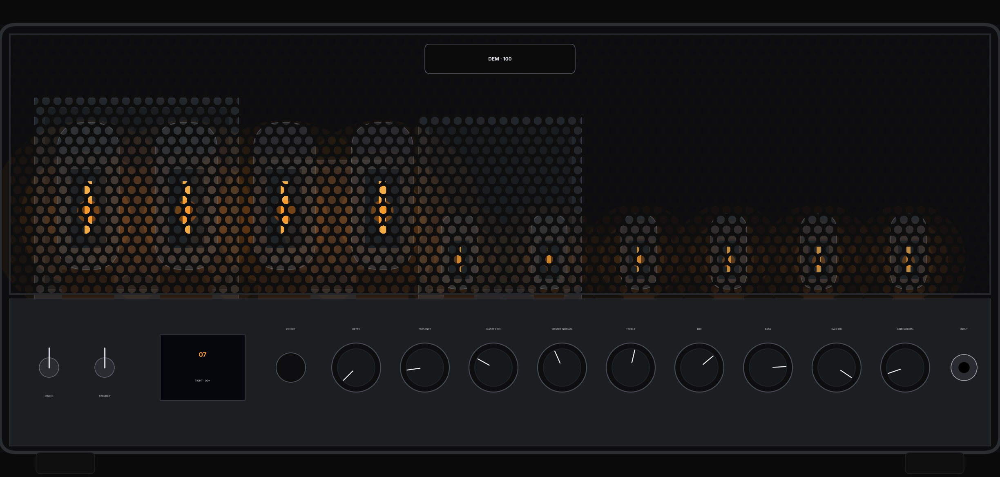
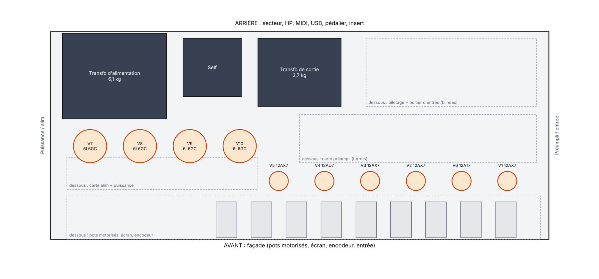
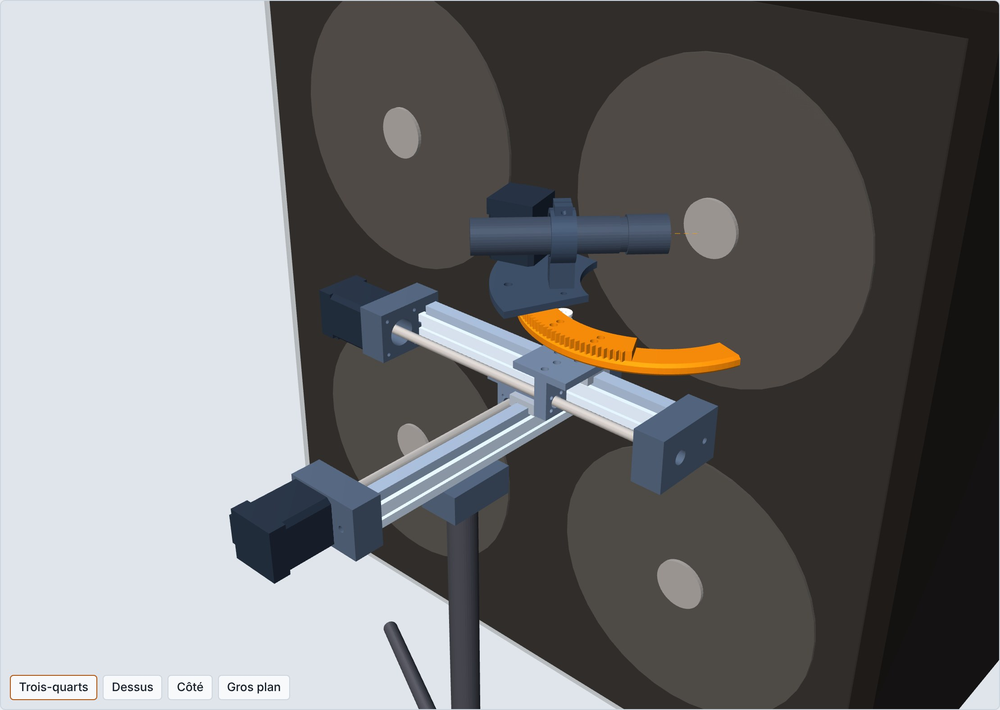

# Ampli SLO pilotable — dossier de conception

*Export du dossier de conception de travail, état du 8 novembre 2026. Les figures interactives du document d'origine sont remplacées par des liens vers les scripts et les données qui les produisent.*

## Objectif et périmètre

Une tête 100 W de la famille SLO-100, entièrement pilotée par presets : chaque potentiomètre est motorisé (le bouton bouge au rappel) et chaque commutation est électronique. On accepte de s'écarter du schéma d'origine tant que le son reste dans la même famille.

- **Puissance** : 4 × 6L6GC, 100 W, étage de puissance gardé propre, dans un baffle mixte (2 Vintage 30, 2 HP de 25 à 30 W) pour jouer à la limite entre serré et saturé.
- **Commandes** : potentiomètres motorisés ALPS RK168 (10 à 100 kΩ standard, 50 V AC max, 0,05 W).
- **Commutations** : canal, crunch/clean, bright, sélection du master.
- **Entrée** : Tube Screamer TS808 et clone de HM-2 en parallèle, dosés par VCA, et noise gate, le tout analogique.
- **Prise de son** : micro sur robot devant le cône, position mémorisée dans le preset.
- **Fabrication** : sans kit ; châssis découpé laser sur plan, câblage sur turret board, transformateurs achetés.

## Schéma de référence et inventaire des commandes

Référence : le schéma annoté du SLO-100 de Rob Robinette (v1.6f). Il compte 9 potentiomètres et 5 commutations ; aucun potentiomètre ne voit de tension continue, tous sont derrière un condensateur de liaison.

| Commande | Valeur d'origine | Nœud | Signal max (ordre de grandeur) |
| --- | --- | --- | --- |
| Normal Gain | 500 kΩ lin. | Branche basse du diviseur crunch/clean, sortie de V1B | 15–30 Vcc |
| OD Gain | 500 kΩ lin. | Branche basse du diviseur 470 k ∥ 2 nF, sortie de V1B ; bright fixe 1 nF | 15–30 Vcc |
| Treble | 250 kΩ lin. | Tone stack, attaqué par la cathode follower V4A | quelques dizaines de Vcc |
| Bass | 1 MΩ log | Tone stack | idem |
| Mid | 25 kΩ lin. | Tone stack | idem |
| OD Master | 1 MΩ log | Curseur du treble, vers le déphaseur | idem |
| Normal Master | 1 MΩ log | Curseur du treble, en parallèle du précédent | idem |
| Presence | 25 kΩ lin. | Boucle de contre-réaction, nœud 39 k / 4,7 k | \~2 Vrms à 100 W |
| Depth (option) | 1 MΩ log | Boucle de contre-réaction, côté secondaire | \~20 Vrms à 100 W |

| Commutation | Réalisation d'origine |
| --- | --- |
| Canal OD / Clean | 4 LDR (VTL5C1) pilotées par le footswitch |
| Crunch / Clean | Inverseur DPDT en façade |
| Bright (canal clean) | Interrupteur, ajoute 470 pF |
| Sélection du master | Via LDR3 / LDR4, liée au canal |
| Boucle d'effets | Jacks send / return |

Les niveaux de signal sont des estimations à confirmer en simulation ; seule la limite ALPS de 50 V AC est contraignante, et elle ne paraît atteinte nulle part en usage normal.

## Architecture retenue

On garde le chemin de distorsion du SLO intact et on modifie seulement les nœuds où sont les commandes. La boucle d'effets disparaît : les effets temporels se feront en post-traitement sur le signal du micro, ce qui libère deux triodes sans ajouter de lampe.

| Bloc | SLO-100 | Version pilotable | Raison |
| --- | --- | --- | --- |
| Boucle d'effets | V3A buffer, atténuateur 99 %, V4B récupération | Supprimée ; la cathode follower du tone stack est couplée en direct à la plaque de OD4, avec un atténuateur dans sa cathode | Libère 2 triodes ; montage déjà éprouvé dans le « Simplified SLO » |
| Pots de gain | 500 k dans des diviseurs 470 k, attaqués par la plaque de V1B | Cathode follower après V1B, diviseurs remis à l'échelle ÷5 (100 k) | Garde la charge de V1B identique à l'origine |
| Tone stack | 250 k / 1 M / 25 k, pente 47 k | Remis à l'échelle autour de 100 k, niveau réduit en amont | Les ALPS ne vont pas au-delà de 100 k |
| Masters | 2 × 1 M log | 2 × 100 k log | Suit le tone stack |
| Presence / depth | 25 k lin. / 1 M log | 20 k lin. (0,12 µF) / 100 k lin. (4,7 nF conservé) | Nœuds à basse impédance, sans difficulté |
| Commutations | 4 LDR + inverseurs mécaniques | 14 LDR et 5 relais (3 dans l'entrée), pilotés par le Raspberry Pi | Commutation silencieuse et isolée galvaniquement |
| Étage de puissance | 4 × 6L6GC, OT 2,2 kΩ, self, redressement silicium | Inchangé | — |
| Alimentation pilotage | — | Transformateur séparé basse tension, masse reliée en un seul point | Bruit et sécurité |

Les lampes deviennent 4 × 12AX7, 2 × 12AU7 et 4 × 6L6GC. V4 passe en 12AU7, montée en White cathode follower pour piloter le tone stack ; une V6 (12AU7) s'ajoute, une moitié en buffer après V1B, l'autre libre pour un étage de gain commutable. Le détail est dans la section suivante.

## Remise à l'échelle des impédances

Tout passe en pots ALPS de 100 kΩ maximum : impédances divisées par 5 sur les gains, par 10 sur le tone stack et les masters. La simulation du tone stack donne au plus 1,6 dB d'écart avec l'original sur 216 combinaisons de réglages, 0,7 dB en moyenne.

> Figure : réponses du tone stack d'origine et remis à l'échelle — script [`sim/tonestack.py`](../sim/tonestack.py), données [`sim/curves.json`](../sim/curves.json).

L'écart résiduel vient surtout de la sortie de la cathode follower, qui n'est pas divisée par 10 : même la remise à l'échelle exacte laisse 1,2 dB. Une source plus basse impédance le réduit.

### Tone stack et masters (÷10)

| Élément | SLO-100 | Version ALPS |
| --- | --- | --- |
| Treble | 250 kΩ lin. | 20 kΩ lin. |
| Bass | 1 MΩ log | 100 kΩ log |
| Mid | 25 kΩ lin. | 2,5 kΩ : ALPS 10 kΩ log à 2 pistes, 3,3 kΩ en parallèle (à 1 dB près des courbes d'un 2,5 kΩ) |
| Résistance de pente | 47 kΩ | 4,7 kΩ |
| Condensateur treble | 470 pF | 5,6 nF (retouché pour le 20 kΩ) |
| Condensateurs bass, mid | 20 nF | 220 nF |
| Masters OD, normal | 2 × 1 MΩ log | 2 × 100 kΩ log |

La contrepartie est l'impédance d'entrée, dont le minimum tombe de 37 kΩ à 3,6 kΩ. Une cathode follower simple en 12AU7 (8,9 mA, 1,6 W) ne la tient pas proprement : la simulation non linéaire donne 1,5 % de distorsion à 20 V crête et 5,6 % à 40 V. Une White cathode follower, sur les deux triodes d'une même 12AU7 (6,5 mA, \~1,2 W chacune), reste à 0,34 % à 40 V, du même ordre que l'original.

> Figure : distorsion de la cathode follower simple et de la White cathode follower sur le tone stack ÷10 — script [`sim/cf_drive.py`](../sim/cf_drive.py), données [`sim/cf_drive.json`](../sim/cf_drive.json).

La sortie de la White CF est vers 233 V : V4 est sur l'enroulement de filaments de 3 A surélevé à +100 V, soit 133 V entre filament et cathode.

### Niveau d'attaque du déphaseur

Les 100 W restent atteignables master au maximum, sur tous les réglages du tone stack : en canal OD saturé, la White CF reçoit 75 à 95 V crête, ce qui laisse une marge de 2,5 à 5 sur le niveau nécessaire au déphaseur. La simulation complète le confirme.

À 100 W, la prise 4 Ω délivre 28 V crête ; la contre-réaction (39 k / 4,7 k) en renvoie 3,0 V crête sur le déphaseur. Pour 50 V crête sur les grilles des 6L6GC (polarisation supposée vers −50 V), le déphaseur en paire différentielle (gain \~25 par côté avec 82 k ∥ 220 k) demande 2,0 V crête différentiels. Il faut donc environ :

```latex
v_{in} \approx \frac{50}{25} + \frac{4{,}7}{43{,}7} \times 28{,}3 \approx 5{,}1\ \text{V crête}
```

La White CF a été repolarisée après la simulation complète : sa grille reçoit 75 à 95 V crête en canal OD saturé, jusqu'à 110 V avec l'étage supplémentaire au maximum, alors qu'elle écrêtait vers 95 V. Alimentée par une cellule de 10 kΩ + 47 µF depuis B+2 (\~416 V), grille à 229 V par un pont 820 kΩ / 1 MΩ, elle passe à 8 mA et reste sous 0,4 % de distorsion jusqu'à 100 V crête au réglage 5-5-5, sous 1 % au pire réglage du tone stack ; elle n'écrête qu'au-delà de 110 V. L'atténuateur placé avant elle (300 kΩ face aux 450 kΩ du pont, −4,4 dB) garde cette marge ; il est pris entre deux condensateurs de liaison de 0,1 µF, avec 220 kΩ vers la masse, pour que la LDR de « poussée » qui le court-circuite travaille à 0 V continu.

### Gains (÷5)

| Élément | SLO-100 | Version ALPS |
| --- | --- | --- |
| OD Gain | 500 kΩ lin., série 470 kΩ ∥ 2 nF, bright 1 nF | 100 kΩ lin., série 91 kΩ ∥ 10 nF, bright 4,7 nF |
| Normal Gain | 500 kΩ lin., séries 470 kΩ (+ 470 kΩ et 39 kΩ en clean), bright 470 pF | 100 kΩ lin., séries 91 kΩ (+ 91 kΩ et 8,2 kΩ), bright 2,2 nF |

Branchés directement sur la plaque de V1B, ces diviseurs la chargent trop : la simulation donne −3,4 dB de gain et deux fois plus de distorsion à 1 kHz. Une cathode follower en 12AU7 (moitié de V6), en liaison capacitive (47 nF), rend le comportement d'origine : gain à 0,5 dB près et même distorsion de 0,1 à 2 V crête. Elle a sa propre cellule d'alimentation (22 kΩ + 47 µF depuis B+2, \~404 V), une grille polarisée à 184 V par un pont 1,2 MΩ / 1 MΩ découplé par 0,47 µF puis une résistance de grille de 1 MΩ, et une cathode sur 47 kΩ (4,1 mA, 0,9 W). Le découplage du pont vient de la simulation de l'alimentation réelle : sans lui, la grille recevait 45 % de l'ondulation de sa cellule.

> Figure : gain et distorsion de V1B chargée par les diviseurs ÷5, avec et sans buffer — script [`sim/v1b_buffer.py`](../sim/v1b_buffer.py), données [`sim/v1b_buffer.json`](../sim/v1b_buffer.json).

Une cathode follower couplée en direct, comme V3A, est écartée : au-delà de 1 V crête, son courant de grille change l'écrêtage de V1B. En 12AX7, elle manque de courant pour tenir les diviseurs. La 12AT7 essayée d'abord est remplacée par une 12AU7, dont la tension filament-cathode admissible est plus haute (environ 200 V contre 90 V selon les fiches RCA, à vérifier sur celle du fabricant choisi). Les grid stoppers de 470 kΩ restent ; la source vue par eux baisse, donc leur coupure haute monte légèrement.

### Presence et depth

Presence : 25 kΩ → 20 kΩ lin., condensateur 0,1 µF → 0,12 µF ; sur une charge de HP, la réponse reste à 0,6 dB de l'original sur toute la course. Depth : la première version (100 kΩ log avec 47 nF) était fausse. Le réseau est en série avec la résistance de contre-réaction de 39 kΩ, qui n'est pas remise à l'échelle : multiplier le condensateur par 10 changeait son poids face à elle, et le depth ne donnait plus que +3,7 dB à 100 Hz au maximum, contre +14,5 dB pour le 1 MΩ d'origine. On garde donc 4,7 nF et 0,1 µF avec un 100 kΩ linéaire : +7,7 dB au maximum, la moitié de la plage en décibels, ce qui couvre la partie utile pour un grave serré. Pour la plage complète, il faut diviser toute la boucle par 10 (39 kΩ → 3,9 kΩ, 4,7 kΩ → 470 Ω, 0,1 µF → 1 µF, 4,7 nF → 47 nF, queue du déphaseur 10 kΩ → 14,3 kΩ pour garder sa polarisation, presence 2,5 kΩ et 1 µF) ; la presence demande alors un 10 kΩ avec une résistance en parallèle, comme le mid. Les niveaux, environ 2 et 20 Vrms à pleine puissance, restent sous les 50 V AC des ALPS.

> Figure : réseaux presence et depth, de l'entrée du déphaseur au HP — script [`spice/depth_test.py`](../spice/depth_test.py), données [`spice/res_depth.json`](../spice/res_depth.json).

Le 100 kΩ linéaire répartit l'effet régulièrement sur la course ; la boucle divisée par 10 recouvre l'original à 0,6 dB près sur toute la course.

### Contraintes des pots motorisés

- 50 V AC et 0,05 W maximum par piste.
- Environ 12 s pour 300° à 4,5 V : un rappel de preset prend plusieurs secondes. Le changement de canal dans un preset reste donc sur LDR, avec deux masters séparés.
- Chaque pot a besoin d'une piste capteur pour l'asservissement : les neuf pots sont des RK16812MG à deux pistes, audio et capteur. Le mid prend un 10 kΩ log avec 3,3 kΩ en parallèle : il n'existe pas de 2,5 kΩ motorisé, et chaque position reste à 1 dB d'une courbe du 2,5 kΩ (spice/mid\_test.py).

## Voicing métal moderne (djent, death technique)

C'est la bonne famille : le Peavey 5150, référence du genre, a été conçu sur la base du SLO-100. Mais le SLO tel quel est voicé années 80, avec un grave moins serré et un peu moins de gain qu'un 5150. Cinq leviers l'amènent au son moderne, tous commutables par preset.

| Levier | Réalisation | Effet |
| --- | --- | --- |
| Boost serré en entrée | Tube Screamer en drive bas, niveau haut | Coupe le grave avant l'écrêtage et resserre l'attaque des cordes graves ; c'est le levier principal |
| Découplages de cathode réduits | 1 µF → 0,47 µF sur V1B et V2A, complément de 0,47 µF remis par relais | Moins de grave amplifié dans les premiers étages |
| Liaison après OD Preamp 2 | 20 nF → 2,2 nF, commuté par relais (tension continue présente) | Coupe le grave à l'entrée du cold clipper |
| Cold clipper | Résistance de cathode 39 k / 10 k / 4,4 k par LDR, changée sous mute (la polarisation bouge) | +11 dB de gain en 10 k, +17 dB en 4,4 k : plus de gain et d'agressivité |
| Noise gate | Après le Tube Screamer et l'insert, commandé par l'enveloppe de la guitare | Indispensable en accordage grave à ce niveau de gain |

L'objectif est de se placer à la frontière entre le son serré type 5150 et le grain « Swedish chainsaw ». Quatre leviers de plus, eux aussi réglables par preset, déplacent le curseur :

- **Baffle** : 4 Eminence Karnivore (60 W, 16 Ω), conçus avec le producteur Kristian Kohle pour le metal moderne, câblés en 16 Ω. À 100 W, chaque HP reçoit 25 W : c'est la plage pour laquelle il est voicé, avec un breakup qu'Eminence annonce « contrôlé ». Les 60 W sont une tenue thermique ; la distorsion et la compression d'un HP de guitare commencent bien avant, dès que l'excursion sort de sa zone linéaire. Le breakup des HP reste donc un ingrédient de la « limite », avec la poussée de l'étage de puissance et l'étage supplémentaire. Variante : 2 Karnivore et 2 Vintage 30 en X, le robot plaçant le micro devant l'un ou l'autre selon le preset.
- **Poussée de l'étage de puissance** : l'atténuateur placé avant la White CF est commuté par LDR, sur le principe du « power amp boost » de Rob Robinette. Plus de signal au déphaseur donne plus de saturation des 6L6GC.
- **Étage de gain supplémentaire** : la triode libre de V6, commutable, rapproche le gain de celui d'un 5150.
- **Circuit type HM-2** dans le boîtier d'entrée, en option, pour le grain chainsaw avant l'ampli.

Avec des HP de 60 W, il n'y a plus de risque de casse à pleine puissance ; le logiciel peut tout de même plafonner le master dans les presets poussés.

### Étage de gain supplémentaire

Il se place dans le chemin OD, entre OD Preamp 2 et l'atténuateur du cold clipper. La simulation complète donne +11 dB de gain en petit signal à 1 kHz et +6 dB à 100 Hz, et le cold clipper sature bien plus tôt : 12,5 % de distorsion pour 100 mV en entrée de V2A, contre 1,6 % sans l'étage.

- **Montage** : atténuateur 1 MΩ / 330 kΩ derrière 1 nF (coupure vers 120 Hz, pour un grave serré), puis demi-12AU7 (V6), plaque 100 k alimentée par sa propre cellule (68 kΩ + 10 µF depuis B+2), cathode 3,3 k ∥ 0,68 µF. La première version de l'atténuateur (47 k / 15 k) restait branchée sur la plaque de V2A, étage coupé compris, et coûtait 4 dB de gain au canal OD : il est maintenant vingt fois plus impédant.
- **Commutation** : deux LDR choisissent le chemin direct ou le chemin par l'étage.
- **Phase** : en mode OD, clean et OD se rejoignent en opposition de phase, sans résistances de mélange ; cet étage inverseur les remettrait en phase. Une LDR en série avec l'atténuateur 2,2 M du clean coupe sa contribution (environ −27 dB, LDR bloquée à \~50 MΩ) quand l'étage est actif.

## Châssis et habillage

La tête mesure 612 × 262 × 282 mm et pèse environ 20 kg. Sa moitié haute est une grille perforée noire derrière laquelle on voit les dix lampes et les transformateurs ; sa moitié basse est la façade du châssis, avec l'écran de presets, l'encodeur, les neuf boutons motorisés et l'entrée.



### Implantation

- **Magnétiques à gauche** : transfo d'alimentation à l'arrière gauche, self, transfo de sortie au centre arrière, tous loin de V1 placée à droite près de l'entrée.
- **Rangée avant** (70 mm du bord) : les six lampes de préampli, de V1 à droite jusqu'au déphaseur V5.
- **Rangée arrière** (112 mm) : les quatre 6L6GC à gauche, plus hautes, visibles derrière le préampli.
- **Sous le châssis** : pots motorisés et écran derrière la façade ; carte préampli au centre droit ; pilotage et boîtier d'entrée blindés à l'arrière droit ; alimentation et puissance à gauche.



### Fabrication

| Pièce | Matière | Format | Fichier |
| --- | --- | --- | --- |
| Châssis, plateau à 4 parois d'une pièce | Acier DC01 1,5 mm, thermolaqué | 600 × 250 × 90 mm ; développé 799 × 425 mm | [`chassis_developpe.dxf`](../mech/out/dxf/chassis_developpe.dxf) |
| Capot en U avec retours | Alu 5754 2 mm, thermolaqué | Développé 1172 × 282 mm | [`capot_developpe.dxf`](../mech/out/dxf/capot_developpe.dxf) |
| Fond | Alu 2 mm | 607 × 282 mm | [`fond.dxf`](../mech/out/dxf/fond.dxf) |
| Grilles avant et arrière (×2) | Tôle perforée noire du commerce | 607 × 162 mm | [`grille_x2.dxf`](../mech/out/dxf/grille_x2.dxf) |

Le châssis repose sur le fond, tenu par 4 vis M4 à travers les retours de ses joues ; les grilles se vissent sur des équerres rivetées dans le capot. Des fentes dans le capot au-dessus des 6L6GC et dans le fond sous la carte de puissance complètent les grilles pour évacuer 150 à 200 W.

À vérifier avant la découpe (calque A\_VERIFIER, en orange sur les plans) : fixations des transformateurs, dont l'orientation sur la fiche Tube-Town est supposée ; fenêtre et vis de l'écran ; découpe de l'embase IEC. La self n'est pas encore choisie. Il faut donc commander ces pièces d'abord. Les fixations des cartes sous le châssis se percent au montage, et le K-facteur de 0,42 est à recaler avec le plieur.

## Estimation du coût

La nomenclature sourcée (77 lignes, tableur joint, avec références, fournisseurs et liens) donne environ 1 520 CHF de composants pour la tête. Avec la TVA suisse à l'import (\~120 CHF), le port et le dédouanement de dix fournisseurs (\~190 CHF) et 5 % d'imprévus, on arrive vers 1 910 CHF, contre 1 680 CHF pour la révision 0.1 : le Raspberry Pi, les Motoron, le clone de HM-2 et les VCA coûtent environ 230 CHF de plus que le NUCLEO et l'entrée à potentiomètres numériques. Le baffle 4×12 en Eminence Karnivore (198 € pièce chez Thomann) ajoute environ 810 CHF, ou 710 CHF avec 2 Karnivore et 2 Vintage 30. Les prix des postes principaux sont relevés en novembre 2026, les autres estimés ; 1 € est compté 0,94 CHF, à ajuster.

> Nomenclature détaillée et sourcée : [`bom/nomenclature_tete_100W.xlsx`](../bom/nomenclature_tete_100W.xlsx) (générée par [`bom/build_bom.py`](../bom/build_bom.py)) ; prix relevés en novembre 2026 quand une source est citée, estimations sinon.

Le cœur incompressible tient en trois postes : transformateurs, lampes et pots motorisés, environ 640 CHF. Les économies sont ailleurs : regrouper les commandes chez Tube-Town et un seul distributeur électronique (\~80 CHF de port en moins), un capot en bois et tolex au lieu de l'aluminium (\~60 CHF), une peinture maison au lieu du thermolaquage (\~50 CHF). On descend alors vers 1 700 CHF pour la tête.

Risque d'approvisionnement : un revendeur indique la version 100 kΩ log du RK16812MG comme arrêtée, avec fin de stock. Il faut confirmer la disponibilité des ALPS avant de figer les valeurs, ou qualifier une alternative.

## Commutations et pilotage

Toutes les commutations passent par des LDR ou des relais, et tous les potentiomètres par des moteurs asservis ; le contrôleur ne touche jamais au chemin audio autrement que par la lumière, un contact, un arbre mécanique ou la tension de commande d'une VCA.

| Fonction | Organe | Côté contrôleur |
| --- | --- | --- |
| Canal, sélection du master | 4 LDR (comme LDR1 à LDR4) | LED par MCP23017 et ULN2803, \~14 mA chacune |
| Crunch / clean | 2 LDR à la place du DPDT | idem |
| Bright | 1 LDR | idem |
| 10 potentiomètres, dont le Blend | ALPS RK168 motorisés | 5 Motoron M2T256 (I²C), piste capteur lue par un MCP3208, boucle de position |
| Mute pendant un rappel | 1 LDR en shunt à l'entrée du déphaseur | Actif tant qu'un moteur tourne, et de 50 ms avant à 300 ms après un changement du cold clipper |
| Surveillance du bias | Résistances 1 Ω dans les cathodes des 6L6GC | MCP6004 (gain 21) et MCP3208, \~40 mV par tube |
| Commande | MIDI (program change), page web et OSC sur Ethernet | Rappel et sauvegarde des presets |

- **Contrôleur** : un Raspberry Pi 4 B pour la tête et le robot. Il n'a ni entrées ni sorties analogiques : une carte d'interface en boîtiers DIP porte deux MCP3208 (pistes capteur, bias, enveloppe du gate), deux MCP4822 (VCA, seuil et fondu du gate), deux MCP23017 et trois ULN2803 (LED des LDR, relais). Ce qui demande un vrai temps réel reste analogique, à commencer par le gate ; le Pi ne fait que régler. Il démarre en une vingtaine de secondes, masquées par la chauffe des lampes ; le système est en lecture seule et les presets s'écrivent de façon atomique, pour couper l'ampli à l'interrupteur sans risque ; Wi-Fi et Bluetooth sont désactivés, le chien de garde actif.
- **Réseau et robot** : l'Ethernet du Pi relie la tête à la régie, sans Wi-Fi, pour la page de commande, l'OSC et le MIDI. Un HAT CAN (MCP2515, interface can0 de Linux) pilote le robot de micro par un câble M12 qui porte aussi son 24 V.
- **Moteurs** : cinq Motoron M2T256 (deux moteurs chacun, I²C) sur une barrette près de la façade, reliés au Pi par un seul câble. PWM à 20 kHz, hors de la bande audio ; ils coupent les moteurs si le Pi cesse d'émettre. Environ 100 mA par moteur en rotation et 150 mA en butée ; on n'en fait tourner que quelques-uns à la fois.
- **Résistance des LDR** : bloquée, plusieurs MΩ, et passante, quelques centaines d'ohms. Face à des nœuds de 10 à 100 kΩ, la fuite et la perte d'insertion restent négligeables.

  La simulation des commutations, détaillée dans la section Vérification, confirme que les LDR et les relais ne claquent pas, à deux exceptions près. Le cold clipper, dont la polarisation change, se commute sous mute, engagé 50 ms avant et relâché 300 ms après. La liaison 2,2 / 20 nF demande une résistance de 4,7 MΩ à la masse sur chaque condensateur, pour garder chargé celui qui n'est pas sélectionné. Les découplages de cathode passent sur relais : la résistance d'une LDR passante, environ 1 kΩ, leur coûtait 1,5 dB vers 300 Hz.
- **Bruit** : alimentation basse tension sur un transformateur séparé, masse reliée en un seul point, I²C et PWM des moteurs arrêtés une fois le preset appliqué, Pi et carte d'interface dans un boîtier d'acier loin de V1.

## Boîtier d'entrée : TS808 et HM-2 en parallèle, gate analogique

Tout le signal reste analogique, dans un compartiment blindé près du jack ; le Pi ne fournit que des tensions de commande et des contacts. Le son visé vient d'un preset Line 6 : un Tube Screamer en boost serré et une HM-2 au Color Mix à fond, Dist à mi-course, mélangés avant l'ampli ; la TS pour la précision djent, une pointe de HM-2 qu'on entend surtout sur les palm mutes. Chaîne du signal :

1. Buffer d'entrée, 1 MΩ (OPA2134).
2. Chemin A : TS808 d'origine, contournable par relais. Chemin B : clone de HM-2, ou une pédale branchée sur l'insert.
3. Une VCA par chemin, puis sommation vers V1B : c'est le mélangeur du Line 6 en analogique, réglé par le bouton Blend motorisé.
4. Noise gate : détection sur la guitare propre, VCA entre les masters et le déphaseur.

### Tube Screamer

Le TS808 tel quel, en 9 V (78L09), avec un NJM4558D et deux 1N914. Le preset le règle en boost : Gain 0,10 (0,15 sur le snapshot Lead), Tone 0,90, Level 0,90. Sur la loi log du 500 kΩ d'origine, 0,10 ne laisse qu'environ 3 kΩ dans la contre-réaction : le drive passe donc sur un ajustable multitour de 100 kΩ (RV501), qui couvre aussi le cas d'une loi linéaire (50 kΩ), et le tone sur un ajustable de 20 kΩ (RV502) ; le niveau est celui de la VCA du chemin A. Les potentiomètres numériques de la révision 0.1 disparaissent : aucun n'existe en boîtier traversant avec la valeur et la tension voulues. Le passage de 0,10 à 0,15 vaut 0,3 dB de gain sur une loi log, 1,8 dB sur une loi linéaire ; pour suivre les snapshots, il faudrait un sixième Motoron et deux pots ALPS (drive de la TS et Dist de la HM-2).

### Clone de HM-2

D'après le schéma Boss de la version japonaise, celle que modélise le Swedish Chainsaw de Line 6, sans la commutation électronique ni le buffer d'entrée :

| Bloc | Original | Clone |
| --- | --- | --- |
| Préampli | Q6 2SC2240, Q7 2SA970 : deux étages à contre-réaction 470 k / 22 k, chacun derrière 47 nF (passe-haut vers 150 Hz) | BC550C, BC560C, mêmes valeurs |
| Dist | 250 kΩ, loi D : extrémités vers le collecteur de Q6 (150 Ω et 10 µF) et vers la jambe de masse de l'écrêteur, curseur à la masse | ajustable 250 kΩ, vers mi-course (Drive 0,50 à 0,60 dans le preset) |
| Écrêtage | IC1b, 220 k ∥ 100 pF ∥ diodes asymétriques (une dans un sens, deux dans l'autre) | NJM4558D, 1N4148 |
| Zone morte | deux germanium 1S188FM tête-bêche en série, puis deux silicium à la masse | 1N34A, 1N4148 |
| Color Mix | gyrateurs : 84 Hz (Low), 0,95 et 1,26 kHz (High), +20 à +22 dB à fond | ajustables 10 kΩ, à fond comme dans le preset (Bass et Treble à 1) |
| Level | 10 kΩ log derrière 10 kΩ | au maximum ; le niveau passe par la VCA du chemin B |
| Alimentation | pile 9 V, ou adaptateur ACA par 330 Ω et une diode | 9 V régulés (78L09) |

La simulation (spice/hm2.py) donne 59 dB de gain avant écrêtage à fond, 24 dB au minimum du Dist, et une sortie saturée vers +3 dBu quel que soit le jeu : 15 à 25 dB au-dessus de la TS, d'où un dosage autour de −20 à −35 dB. Les deux germanium en série font aussi office de petit gate : en dessous de 0,2 V environ rien ne passe, si bien que le souffle du préampli de la HM-2 s'arrête là dans les silences. L'insert reçoit la guitare tamponnée : une HM-2 du commerce s'y compare directement au clone.

### Pourquoi ce mélange marche, et pourquoi il est si sensible

- La TS n'amplifie pas le grave : son gain ne monte qu'au-dessus d'environ 720 Hz. La HM-2, Color Mix à fond, le gonfle (+20 dB à 84 Hz). Sous quelques centaines de hertz, la HM-2 pèse donc bien plus que dans les médiums : au réglage du preset, elle arrive 12 dB sous la TS à 82 Hz en jeu léger, contre 24 dB sous elle à 440 Hz. D'où le côté baveux des palm mutes et la précision ailleurs.
- L'ampli sature ensuite la somme. Dans un étage saturé, le signal le plus faible est écrasé (effet de capture, jusqu'à 6 dB dans un écrêteur dur), et la fréquence où l'un prend le dessus sur l'autre bouge vite avec le dosage. Chaque preset garde donc le blend et le gain ensemble.
- La sortie de la TS suit l'attaque, celle de la HM-2 non : en fin de note et en jeu léger, la HM-2 pèse relativement plus.

### Retrouver le son du Line 6

La topologie est la même, mélange avant l'ampli donc avant le tone stack : le mécanisme se transpose, pas les chiffres. Les niveaux numériques du Line 6 ne sont pas des volts et un modèle n'est pas un clone : ces réglages sont un point de départ. Réglages du preset (snapshot Rythm ; entre parenthèses, les autres snapshots) :

| Bloc | Preset | Dans la tête |
| --- | --- | --- |
| Whammy, en tête de chaîne | actif sauf en Lead | une pédale devant la tête |
| Scream 808, chemin A | Gain 0,10 (0,15 en Lead, coupé en Crunch), Tone 0,90, Level 0,90 | RV501 vers 3 kΩ, RV502 vers 0,9 ; VCA A à −4 dB |
| Swedish Chainsaw, chemin B | Drive 0,60 (0,50 en Djenty, coupé en Crunch), Bass 1, Treble 1, Level 0,60 | Color Mix à fond, RV503 vers mi-course ; VCA B à −46 dB |
| Fusion | A 0 dB, B −30 dB, polarité normale | 42 dB entre les deux VCA, K503 au repos |
| Gates | à l'entrée −44 dB (−40 à −50) ; après la fusion −60 dB (−40 en Djenty, coupé en Lead et Crunch) ; decay 10 ms | gate analogique, fermeture à 10 ms (RV801), seuil par preset |
| Après le baffle | égaliseur +1 dB à 1 kHz, +2,5 dB à 2 kHz, +4,5 dB à 4 kHz, +4 dB à 8 kHz (et un léger coupe-bas en Lead) ; delay et reverb en Lead seulement | dans la DAW |

Ce que valent ces réglages, calculés sur les modèles des deux pédales (spice/preset\_levels.py, lois logarithmiques supposées pour les Level et le drive de la TS) : le Level de la TS à 0,90 vaut −4 dB, celui de la HM-2 à 0,60 −16,5 dB, et la fusion retire 30 dB au chemin B, soit 42 dB d'écart à sortie égale. Mais la HM-2 sort saturée vers +3 dBu quand la TS ne sort que −27 à −7 dBu. À l'entrée de l'ampli, par rapport à la TS, la HM-2 arrive donc à :

| Note | Jeu léger (30 mV crête) | Moyen (100 mV) | Fort (300 mV) |
| --- | --- | --- | --- |
| 82 Hz | −11,6 dB | −21,9 dB | −30,9 dB |
| 110 Hz | −14,2 dB | −24,4 dB | −32,2 dB |
| 440 Hz | −23,7 dB | −30,7 dB | −34,6 dB |
| 1 kHz | −20,3 dB | −26,1 dB | −30,1 dB |

C'est le « peu de HM-2 » du preset en chiffres : 12 dB sous la TS sur un mi grave joué doucement, plus de 30 dB sous elle sur une attaque franche. Dans la tête, clones au Level maximum, le même dosage donne VCA A à −4 dB et VCA B à −46 dB : c'est le point de départ du Blend, à une dizaine de décibels près, puisque la loi des potentiomètres du Helix n'est pas publiée. Méthode pour le recaler :

1. Enregistrer des DI des riffs de référence.
2. Les repasser dans le Line 6 avec la TS seule, puis la HM-2 seule, sans ampli ni HP : ce sont les cibles de chaque pédale.
3. Régler les ajustables des clones jusqu'à coller à ces cibles sur les mêmes DI (spectre, niveau, forme d'onde).
4. Doser sur le vrai ampli, au micro du robot, contre le preset complet, en partant de −4 et −46 dB. Le chemin B est en polarité normale dans le preset, mais la phase du clone n'est pas forcément celle du modèle : essayer les deux positions du relais K503.

### VCA et commandes

Deux AS2164 d'Alfa (DIP-16, brochage du SSM2164), disponibles en boîtier traversant ; le THAT 2181 de la révision 0.1 porte désormais une mention de fin de vie chez THAT. À 0 V de commande la VCA est à 0 dB, puis +33 mV/dB d'atténuation : les MCP4822 (0 à 2,048 V), multipliés par 1,62, couvrent 0 à −100 dB au pas de 0,02 dB. Le chemin A est remonté de 12 dB avant sa VCA et redescendu d'autant à la sommation, si bien que le souffle des VCA n'ajoute qu'environ 2 dB à celui de l'ampli, gate ouvert. La constante de commande suit kT/q (−3300 ppm/K) : une DS18B20 collée sur la VCA donne la température au Pi, qui corrige ; sans cela, 20 °C de plus décaleraient un dosage à −15 dB de 1 dB. Le bouton Blend motorisé commande la VCA B : −∞ en butée basse, −20 dB en butée haute, et l'essentiel de la course entre −60 et −30 dB, là où se joue le dosage du preset.

### Noise gate

La détection se fait sur la guitare propre, au buffer d'entrée, et l'action après le préampli, comme un ISP Decimator branché en « 4 câbles » : le gate coupe aussi le souffle des étages à lampes, de la TS et de la HM-2, et ses décisions restent nettes puisque le signal de détection n'est pas compressé.

- Détection : gain ×11 avec passe-haut à 48 Hz, redressement double alternance de précision, détecteur de crête (1 µF, 22 kΩ, soit 22 ms), comparateur LM393 à hystérésis contre le seuil fixé par le Pi.
- Forme : ouverture en 0,1 ms, fermeture réglable de 10 à 450 ms par un ajustable, mise à 10 ms comme le decay des deux gates du preset ; commande bornée à 0 V pour que le gate ouvert soit exactement à 0 dB. Le Pi peut aussi fondre le signal (DAC\_FADE) et neutraliser le gate (GATE\_OFF, gate ouvert par défaut au démarrage) ; chaque preset garde son seuil, comme les snapshots du Line 6.
- VCA : un AS2164 entre la sélection des masters et le déphaseur, avec un tampon et un convertisseur courant-tension OPA2134, sur une petite carte près de V5. Le signal n'y dépasse pas quelques volts, dans la plage d'une VCA en ±15 V. Le mute LDR304 reste en amont.

## Vérification par simulation

L'ampli complet a été simulé dans ngspice, en version SLO-100 d'origine puis en version pilotable : alimentation, préampli, tone stack, déphaseur, quatre 6L6GC et transfo de sortie couplé, avec la contre-réaction. La version pilotable reproduit l'original à moins de 1 dB, avec la même distorsion, les mêmes marges de stabilité, et toutes les lampes restent dans leurs limites.

| Mesure | SLO-100 | Version pilotable |
| --- | --- | --- |
| Sortie HP, canal OD (gain 7, master 3), 0,3 V à 1 kHz | 11,5 V crête, distorsion 60 % | 10,2 V crête (−1,1 dB), 63 % |
| Idem à 100 Hz | 18,0 V crête, 27 % | 15,2 V crête (−1,5 dB), 27 % |
| Canal crunch (gain 5), 0,3 V à 1 kHz | 11,2 V crête, 60 % | 10,1 V crête (−0,9 dB), 61 % |
| Attaque du déphaseur pour environ 100 W | \~4 V crête | \~4 V crête |
| Courant HT au repos | 169 mA | 177 mA (étage supplémentaire compris) |
| Marge de phase de la contre-réaction, HP réel | 31° | 38° |
| Étage de gain supplémentaire | — | +11 dB à 1 kHz, +6 dB à 100 Hz |

Modèles : tubes de Koren, transfo de sortie de 18,5 H avec fuites et capacités de bobinage estimées, HT représentée pour ces mesures par une source de 509 V à 45 Ω (le vrai redresseur est traité plus bas). Les puissances absolues restent optimistes ; les écarts entre les deux versions sont fiables. La version pilotable est 1 à 1,5 dB sous l'original en niveau, à distorsion égale : c'est l'atténuateur gardé avant la White CF pour sa marge, et le master le rattrape.

La simulation a imposé quatre corrections, déjà reportées plus haut :

- **Alimentations dédiées** : buffer de V1B (22 kΩ + 47 µF), White CF (10 kΩ + 47 µF depuis la seconde campagne) et étage supplémentaire (68 kΩ + 10 µF), tous depuis B+2. Sans elles, leurs courants faisaient chuter B+3 à B+5 de 40 à 60 V. La chute B+2 → B+3 passe de 10 kΩ à 13 kΩ pour garder les tensions d'origine.
- **V6 en 12AU7** au lieu de 12AT7, pour la tension filament-cathode.
- **Filaments surélevés** : enroulement principal (6L6GC et 12AX7) à +60 V, enroulement de 3 A (V4 et V6) à +100 V. Les cathodes à \~200 V de V3A, V4 et V6 restent alors à moins de 150 V de leurs filaments.
- **Condensateurs de B+3 à B+5 en 550 V** : lampes froides, ces nœuds montent vers 509 V.

Ce que la simulation ne peut pas garantir : l'absence d'oscillation parasite liée au câblage (le SLO y est sensible avec son gain), la ronflette, la microphonie, et le comportement haute fréquence du vrai transfo de sortie. Dans le modèle, la marge de stabilité est mince sur charge purement résistive avec presence au minimum, exactement comme pour l'original : c'est à mesurer au prototype.

Une seconde campagne a simulé ce que la première laissait de côté : l'alimentation avec un vrai redresseur, chaque mode commutable, la depth et la presence sur une charge de HP, les claquements de commutation, le bruit et le boîtier d'entrée. Elle a trouvé six défauts dans la version pilotable, corrigés plus haut.

### Alimentation réelle

Le secteur passe maintenant par un modèle de transformateur (2 × 538 V crête à vide, 40 Ω et 20 mH par demi-enroulement) et deux diodes par branche, au lieu d'une source de 509 V à 45 Ω.

| Mesure | SLO-100 | Version pilotable |
| --- | --- | --- |
| B+1 au repos / à pleine puissance | 497 / 456 V | 497 / 454 V |
| B+2 au repos / à pleine puissance | 495 / 447 V | 493 / 445 V |
| Ondulation à 100 Hz : B+1, B+2, préampli | 2,3 V ; 6 mV ; moins de 0,03 mV crête | 2,4 V ; 6 mV ; moins de 0,03 mV crête |
| Puissance sur 4 Ω, déphaseur attaqué à 5 V crête | 127 W, distorsion 2,6 % | 130 W, 3,2 % |
| Ronflette due à l'ondulation, master 3 / master 10 | −132 / −106 dB sous 100 W | −117 / −92 dB sous 100 W |

L'affaissement de 8 % à pleine puissance, deux fois et demie celui du modèle simplifié, est typique d'un redressement silicium suivi d'une self ; il rapproche la puissance simulée des 100 W réels, le modèle de 6L6GC restant optimiste. La ronflette due à l'ondulation est négligeable dans les deux versions : celle du prototype viendra des filaments et du câblage. La version pilotable en a un peu plus que l'original ; le découplage ajouté au pont de grille du buffer de V1B lui a fait gagner 8 dB.

### Modes commutables

Chaque mode a été simulé en petit signal, réponse au HP de 10 Hz à 20 kHz, et en grand signal, à 50 et 300 mV à 100 Hz et 1 kHz ; canal OD au gain 7, master 3.

| Mode | Effet simulé | Par rapport à l'original |
| --- | --- | --- |
| Canal OD | Distorsion 27 % à 100 Hz, 63 % à 1 kHz (300 mV) | Niveau −1,1 à −1,5 dB, même distorsion |
| Crunch, clean | — | −0,6 à −1,4 dB |
| Bright du canal clair | +5 dB vers 5 kHz | À 0,2 dB près |
| Cold clipper 10 k / 4,4 k | +11 / +17 dB de gain avant saturation | Nouveau |
| 4,4 k couplé en alternatif | +13 dB, polarisation froide gardée, harmonique 2 trois fois plus forte | Variante |
| Découplages réduits | −2,8 dB à 100 Hz, −3,1 dB à 300 Hz | Nouveau |
| Liaison de 2,2 nF | −3,2 dB à 60 Hz, −1,6 dB à 100 Hz | Nouveau |
| Poussée | +4,4 dB vers l'étage de puissance ; 21 V crête au lieu de 15 V à 100 Hz | Nouveau |
| Étage supplémentaire | +11 dB à 1 kHz, +6 dB à 100 Hz | Nouveau |
| Preset serré (4,4 k, découplages réduits, 2,2 nF) | +17 dB à 1 kHz mais +12,5 dB à 60 Hz | Nouveau |

Les modes de l'original sont reproduits à 1,5 dB près, à distorsion égale ; l'écart, surtout un niveau un peu plus bas, vient de l'atténuateur gardé avant la White CF, et le master le rattrape. La liaison de 2,2 nF agit peu en petit signal, sa coupure tombant vers 50 Hz ; un 1 nF la remonterait vers 110 Hz si l'effet est trop discret à l'écoute. Avec le réseau depth, les marges de stabilité de la contre-réaction restent celles de l'original, et la depth les améliore dans le grave.

### Commutations et claquements

Les LDR sont simulées avec leur dynamique (63 % de la conductance en 2,5 ms à l'allumage, 35 ms jusqu'à 100 kΩ à l'extinction) et les relais en 0,3 ms. Mesure : pic de tension au HP après la commutation, sans signal, master 3.

| Commutation | Pic au HP | Verdict |
| --- | --- | --- |
| Canal, crunch/clean, bright, poussée, étage supplémentaire, découplages | 0,1 à 26 mV (−61 à −116 dB sous 100 W) | Silencieuses |
| Liaison 2,2 / 20 nF, condensateurs gardés chargés par 4,7 MΩ | 1,6 mV (−85 dB) | Silencieuse |
| La même, condensateur non sélectionné laissé flottant | 19 V (−4 dB) | À proscrire |
| Cold clipper 39 k → 4,4 k, direct | 11 V (−8 dB), pendant 0,2 s | Claquement grave |
| Le même, LDR à transition lente | 6,7 V (−13 dB) | Insuffisant |
| Le même, mute engagé 5 ms avant | 1,5 V (−26 dB) | Insuffisant |
| Le même, mute engagé 50 ms avant, relâché 300 ms après | 15 mV (−65 dB) | Retenu |
| Variante couplée en alternatif | Rien de mesurable | Sans claquement |

Règle pour le logiciel : tout changement du cold clipper se fait sous mute, engagé 50 ms avant et relâché 300 ms après. Pendant un rappel de preset, les moteurs tournent plus longtemps : la règle ne coûte rien, et ne s'entend que si deux presets ne diffèrent que par le cold clipper.

### Bruit

Bruit thermique des résistances et bruit de grenaille des lampes, représenté par une résistance de 2,5/gm dans chaque grille ; le bruit en 1/f des lampes n'est pas modélisé. Bande de 20 Hz à 20 kHz, rapport signal sur bruit compté depuis 100 W.

| Mesure | SLO-100 | Version pilotable |
| --- | --- | --- |
| Canal OD, master 3 | 28 mV au HP, 57,0 dB | 26 mV, 57,7 dB |
| Canal OD, master 10 | 32,5 dB | 33,1 dB |
| Crunch, master 3 | 73,5 dB | 73,2 dB |
| Clean | 82,2 dB | 83,7 dB |
| Bruit ramené à l'entrée | 4,8 µV (34 nV/√Hz) | 4,8 µV |

La remise à l'échelle n'ajoute de bruit nulle part. La résistance de grille de 68 kΩ de V1B fait à elle seule 97 % du souffle du canal OD. Comme le boîtier d'entrée attaque V1B en basse impédance, on peut la descendre à 10 ou 33 kΩ, soit 3 à 8 dB de souffle en moins, à valider au prototype pour la stabilité haute fréquence.

### Boîtier d'entrée

TS808 d'origine (spice/ts.py, 9 V, drive à 10 %, tone à mi-course, level au maximum) et HM-2 à fond (spice/hm2.py, valeurs du schéma Boss), sinus à l'entrée :

| Entrée | TS808, sortie | HM-2, sortie |
| --- | --- | --- |
| 82 Hz, 30 mV crête | −22,8 dBu | +3,7 dBu |
| 440 Hz, 30 mV crête | −12,7 dBu | +0,2 dBu |
| 1 kHz, 100 mV crête | −10,1 dBu | +4,0 dBu |
| 1 kHz, 300 mV crête | −6,8 dBu | +3,7 dBu |

Color Mix à fond : +20,4 dB à 84 Hz, +22,2 dB à 946 Hz, +22,4 dB à 1,26 kHz, +3,6 dB à 300 Hz ; réponse plate à mi-course ; −20,7 dB vers 1,1 kHz au minimum. Gain avant écrêtage : 58,7 dB vers 750 Hz à fond, 24 dB au minimum du Dist. La HM-2 sature sa propre égalisation : la sortie de son étage Color Mix bute à ±3 V en 9 V, quel que soit le jeu.

### Corrections issues de cette campagne

Elles sont reportées dans les sections concernées, dans la nomenclature et dans les fichiers de simulation.

1. Étage supplémentaire : atténuateur d'entrée 47 k / 15 k → 1 MΩ / 330 kΩ derrière 1 nF ; branché en permanence sur la plaque de V2A, il coûtait 4 dB au canal OD.
2. Découplages de cathode de V1B et V2A commutés par relais : une LDR passante, environ 1 kΩ, leur coûtait 1,5 dB vers 300 Hz.
3. White CF repolarisée (cellule de 10 kΩ, pont 820 kΩ / 1 MΩ, 8 mA) : elle recevait jusqu'à 110 V crête et écrêtait vers 95 V. Son atténuateur passe à 300 kΩ, entre deux liaisons, pour une LDR de poussée à 0 V continu.
4. Depth : 100 kΩ linéaire avec 4,7 nF, au lieu de 100 kΩ log avec 47 nF.
5. Buffer de V1B : pont de grille découplé par 0,47 µF puis 1 MΩ, liaison de 47 nF.
6. Commutations : cold clipper sous mute, résistances de 4,7 MΩ sur la liaison 2,2 / 20 nF, noise gate après le TS.

Le modèle a aussi gagné la capacité de bobinage du transfo de sortie (470 pF par demi-primaire) et des bornes numériques dans les modèles de lampes, sans effet dans la plage normale de fonctionnement.

## Schéma KiCad

Le schéma complet est dessiné en KiCad : 8 feuilles et 560 composants, générés par script et vérifiés contre la simulation. Les 168 éléments du modèle SPICE s'y retrouvent avec les mêmes nœuds et la même valeur, à la série normalisée près (huit écarts de 3 à 18 %) ; la TS et la HM-2 ont leurs propres modèles. Tout est publié sur [GitHub](https://github.com/Arnwald/slo-pilote) sous licence CERN-OHL-S v2.

| Feuille | Contenu |
| --- | --- |
| Alimentation | secteur, TT-SLO100, B+1 à B+5 et cellules dédiées, polarisation, filaments, terre |
| Préampli | V1B, buffer V6A, diviseurs, V1A, V2A, liaison commutable, étage V6B, cold clipper, V3 |
| Tone stack et déphaseur | atténuateur, White CF, tone stack ÷10, masters, mute, déphaseur, presence, depth |
| Puissance | 4 × 6L6GC, mesure du courant, transfo de sortie, sélecteur d'impédance |
| Boîtier d'entrée | buffer, TS808 en 9 V, clone de HM-2 en 9 V, insert, relais de chemin et de polarité |
| Pilotage | alimentations ±15 V et 24 V, Raspberry Pi 4 B et HAT CAN, carte d'interface, écran, encodeur, pédalier, MIDI, mesure du bias |
| Commandes | 5 Motoron M2T256, moteurs et pistes capteur des 10 pots, LED des LDR, bobines des relais |
| VCA et noise gate | mélange TS / HM-2 par deux VCA, tensions de commande, détection du gate, VCA entre masters et déphaseur |

Chaque broche porte le nom de son nœud, repris de la simulation. On peut donc déplacer les composants dans KiCad sans rien débrancher, puis redessiner les liaisons au fil de l'implantation.

Le dessin a corrigé plusieurs points :

- Le tone stack est attaqué par la sortie de la White CF, à 233 V continus : ses trois condensateurs passent en 630 V.
- Les 330 kΩ des ponts de surélévation voient environ 440 V : ils passent en 3 W, pour une tension de service de 750 V.
- Le TT-SLO100 a une prise de polarisation à 60 V et des enroulements de chauffage à point milieu. La polarisation se règle de −43 à −66 V, et les points milieux vont aux références de +62 et +99 V.
- Le 5 V des moteurs et le robot passent par un module secteur 24 V. Le petit transfo de pilotage (2 × 15 V, 10 VA) ne fournit plus que les ±15 V analogiques, avec de la marge pour le 7815.
- Le mid devient un RK16812MG 10 kΩ log avec 3,3 kΩ en parallèle, à 1 dB près des courbes d'un 2,5 kΩ.
- Sens des pots : la broche 1 est l'extrémité anti-horaire. Bass et depth vont entre 1 et le curseur, presence entre 3 et le curseur, pour que tout augmente en tournant à droite.
- Les découplages de cathode passent en film 63 V au lieu d'électrolytiques.
- Les nœuds du tone stack et du Tube Screamer portaient le même préfixe, qu'une étiquette globale aurait reliés : ceux du tone stack s'appellent désormais STK.

Écarts voulus avec le modèle : B+1 en 2 × 470 µF série (235 µF pour 200 µF simulés), B+2 en 2 × 220 µF série (110 µF pour 100 µF), et le mid. La nomenclature a été recomptée sur le schéma, et l'estimation des coûts en tient compte.

Révision 0.2 du 8 novembre 2026 :

- Pilotage : Raspberry Pi 4 B avec HAT CAN, carte d'interface en boîtiers DIP, cinq Motoron M2T256. Plus de NUCLEO, W5500, PCA9685, DRV8833 ni MCP41HV51 : il ne reste aucun composant CMS à souder.
- Entrée : TS808 et clone de HM-2 en 9 V, insert, relais de polarité ; nouvelle feuille VCA et noise gate, avec le bouton Blend (dixième pot motorisé, sans audio).
- Gate : la VCA s'insère entre la sélection des masters (PI\_IN) et le condensateur de liaison du déphaseur (PI\_DRV). Le modèle SPICE la représente par un tampon idéal de gain 1, et la comparaison reste sans défaut.
- Protection des entrées de mesure du bias en BAT85 traversantes au lieu de BAT54.

## Câblage et implantation

La simulation ne voit ni les boucles de masse, ni les couplages entre fils, ni les filaments : sur un ampli de ce gain, ce sont eux qui décident de la ronflette, du souffle et de la stabilité. Les règles ci-dessous sont classées par importance.

### Masses

1. Le point milieu HT du transfo d'alimentation va directement au moins du condensateur de B+1, par un fil dédié : c'est là que passent les impulsions de charge, de plusieurs ampères crête.
2. Les retours de l'étage de puissance se regroupent au même endroit : résistances de 1 Ω des cathodes des 6L6GC, condensateur de B+2, polarisation.
3. Préampli : chaque étage ramène ses retours (cathode, résistance de fuite, potentiomètres) au moins du condensateur qui l'alimente, puis un seul fil par cellule rejoint la masse principale, dans l'ordre de B+1 vers l'entrée.
4. Un seul point de liaison au châssis, près du jack d'entrée, avec des jacks isolés. La terre secteur a sa propre vis, rondelle éventail et contre-écrou, jamais partagée.
5. La masse du pilotage (transfo basse tension, Raspberry Pi, contrôleurs de moteurs) rejoint la masse audio en un seul point, au boîtier d'entrée, jamais par le châssis ni par les blindages.

### Filaments

- Paires torsadées serrées, plaquées dans les angles du châssis, croisant les fils de signal à 90° ; rien ne passe près de V1.
- Surélévation : +60 V pour l'enroulement principal, +100 V pour celui de 3 A (V4 et V6), par un pont découplé par 47 µF relié au point milieu artificiel (2 × 100 Ω). Pas de point milieu à la masse.
- Si une ronflette résiduelle vient de V1, la chauffer seule en continu (6,3 V régulé) ; l'emplacement est à prévoir dès le départ.

### Haute tension et sortie

- Fils de plaque des 6L6GC torsadés par paire jusqu'au transfo de sortie ; transfos d'alimentation et de sortie à 90° l'un de l'autre, comme sur l'implantation.
- Fil de contre-réaction (prise 4 Ω, réseau depth, déphaseur) en paire torsadée avec son retour, loin de V1 et V2 : c'est la cause classique d'oscillation d'un ampli à fort gain.
- Résistances soudées directement aux broches des supports : grid stoppers de 68 k (V1B), 470 k (V2A), 220 k (V3B), 2,2 k sur chaque 6L6GC, résistances d'écran de 470 Ω.

### Signal

- Câble blindé du boîtier d'entrée à la grille de V1B, blindage relié d'un seul côté (carte).
- Potentiomètres motorisés : piste audio en câble blindé court ; piste capteur et moteur dans un faisceau basse tension séparé, qui ne longe pas les fils audio.
- LDR et relais soudés sur la carte, au nœud qu'ils commutent ; leurs commandes arrivent en paires torsadées.
- L'ordre physique suit le schéma : V1 près de l'entrée, puis les étages par gain croissant, le déphaseur et les lampes de puissance à l'autre bout.

### Pilotage et basse tension

- Électronique de pilotage dans son boîtier blindé ; I²C et PWM des moteurs arrêtés une fois le preset appliqué ; le Pi, qui tourne en permanence, reste dans son boîtier d'acier.
- Moteurs : 100 nF aux bornes de chacun, ferrite en série, fils torsadés ; drivers en roue libre au repos.
- Mesure du bias : entrées ADC protégées par 10 kΩ en série et des diodes d'écrêtage ; une lampe qui flashe peut envoyer une impulsion sur la résistance de 1 Ω.
- Toutes les LDR travaillent à moins de 5 V continu, grâce à l'atténuateur de poussée placé entre deux condensateurs de liaison : la tenue d'isolement entre LED et cellule n'est jamais sollicitée.

## Mise en route

La première mise sous tension se fait par étapes, avec une lampe série de 60 à 100 W sur le secteur, une charge fictive de 100 W minimum, et jamais sans charge sur la sortie. Les tensions HT sont mortelles ; les condensateurs se vident en plusieurs minutes, il faut les décharger à la main avant toute intervention.

1. Sans lampes ni fusible HT : vérifier le chauffage (6,3 V ± 5 %), les surélévations (+60 V, +100 V), puis l'alimentation basse tension, le Raspberry Pi, les moteurs et les LED des LDR.
2. Vérifier la polarisation avant d'insérer les 6L6GC : environ −55 V réglable sur chaque grille, ajustables au plus négatif.
3. Lampes de préampli seules, standby fermé : contrôler B+3 à B+5 et les cellules dédiées.
4. Avec les 6L6GC et la charge fictive : régler chaque lampe vers 38 mA, soit 38 mV aux bornes de sa résistance de 1 Ω (environ 63 % de la dissipation maximale).
5. Comparer au tableau ci-dessous ; un écart de ±10 % est normal, les lampes réelles variant de ±20 %.
6. Sinus de 1 kHz à 100 mV : suivre le signal étage par étage à l'oscilloscope.
7. Signal carré de 1 kHz sur la charge fictive, presence au minimum puis au maximum : pas d'oscillation ni de sonnerie prolongée. Sinon, porter le condensateur entre les plaques du déphaseur de 47 pF à 100 pF, ou ajouter un réseau RC sur le secondaire.
8. Pleine puissance sur la charge fictive, puis seulement les haut-parleurs, à faible volume.

| Point | Tension attendue (simulation) |
| --- | --- |
| B+1 (plaques 6L6GC) | 501 V |
| B+2 (écrans) | 499 V |
| B+3 / B+4 / B+5 | 386 / 368 / 360 V |
| Cellules buffer / White CF / étage sup. | 404 / 416 / 358 V |
| V1B plaque / cathode | 188 / 1,4 V |
| V1A plaque / cathode | 263 / 2,1 V |
| V2A plaque / cathode | 258 / 2,0 V |
| V2B (cold clipper) plaque / cathode | 357 / 4,3 V |
| V6 buffer grille / cathode | 184 / 193 V |
| V6 étage sup. plaque / cathode | 151 / 6,8 V |
| V3B plaque / cathode | 201 / 1,5 V |
| V3A cathode | 202 V |
| White CF : plaque haute / sortie / cathode basse | 389 / 233 / 8,1 V |
| Déphaseur : plaques / cathodes / queue | 260 et 252 / 42 / 41 V |
| 6L6GC : polarisation / courant cathode | −55 V / 38 mA |

Le Koren sous-estime un peu le courant des 12AX7 : sur le schéma annoté de l'original, B+3 vaut 378 V, B+4 350 V et la queue du déphaseur 32,5 V. Ces valeurs sont donc aussi plausibles.

## Robot de micro

Trois servomoteurs, un par réglage, pilotés par le contrôleur de la tête : position radiale de la capsule, distance au tissu et angle autour de la capsule. La maquette 3D ([`robot/web/robot_micro.html`](../robot/web/robot_micro.html), à ouvrir dans un navigateur) se manipule avec trois curseurs.

Deux moteurs ne suffisent pas sans renoncer à quelque chose. Lier l'angle à la position, pour viser toujours le cache, interdit la comparaison la plus courante : dans l'axe ou à 45° au même endroit. Un embrayage qui aiguille un moteur vers deux axes demande lui-même un actionneur, pour une économie d'environ 20 €. Pour n'en garder que deux, mieux vaut régler l'angle à la main.

L'angle est un goniomètre : le chariot du micro roule sur un arc denté centré sur la capsule. Tourner le micro ne déplace donc pas la capsule, et les trois réglages restent indépendants, comme on les décrit au studio. Rien ne dépasse devant la capsule : l'arc est à 84 mm derrière elle.



| Axe | Course | Entraînement | Codeur (14 bits) |
| --- | --- | --- | --- |
| Position radiale | −15 à +135 mm du centre du cache | rail MGN12H, vis T8 pas 2 mm | 0,12 µm |
| Distance capsule – tissu | 10 à 160 mm | rail MGN12H, vis T8 pas 2 mm | 0,12 µm |
| Angle | ±50° | arc de 148 dents m 1,5, pignon de 14 dents | 0,002° |

- **Commande** : par le Raspberry Pi de la tête, sur le bus CAN de son HAT. Un seul câble M12 porte le CAN et le 24 V ; le robot n'a que trois servomoteurs pas à pas en boucle fermée (MKS SERVO42D), qui renvoient la position de leur codeur.
- **Régie** : en Ethernet vers la tête, sans Wi-Fi, par une page web servie par la tête et en OSC (`/micro/position 25 20 30`). La position du micro peut entrer dans les presets.
- **Silence** : les servos sont désactivés 250 ms après chaque mouvement. Les vis T8 pas 2 mm sont irréversibles et l'arc tient par démultiplication.
- **Garde au tissu** : la face du SM57 est à D − 8 cos A − 16 |sin A| du tissu. Le logiciel de la tête refuse toute cible à moins de 2 mm et recule avant de tourner ; un écart de suivi des codeurs arrête tout.
- **Mécanique** : pièces PETG au format d'un plateau de 25 cm, inserts M3, manchon TPU autour du micro. Le modèle ne montre aucune collision entre pièces mobiles aux positions extrêmes.
- **Pied** : 2,8 kg avec le SM57, centre de masse au-dessus de l'adaptateur 3/8". La capsule est 17 cm au-dessus de l'adaptateur : il faut un pied court à embase lourde pour les HP du haut d'un 4×12 posé au sol.
- **Coût** : environ 215 € de pièces pour le robot ; l'Ethernet, le CAN et le module 24 V sont comptés dans la tête.

Les fichiers (modèle CadQuery paramétrique, STEP, STL, notes de pilotage CAN) sont dans le dossier [`robot/`](../robot/).

## Points ouverts et prochaines étapes

La simulation couvre maintenant tout le circuit, alimentation, commutations et bruit compris ; ce qui reste se règle au prototype ou chez les fournisseurs.

- [ ] Fixer à l'écoute : l'apport de l'étage supplémentaire (+11 dB simulés), la variante du cold clipper 4,4 k (continu sous mute, ou alternatif sans claquement) et la plage du depth (100 kΩ lin. ou boucle divisée par 10).
- [ ] Au prototype : polarisation des 6L6GC, stabilité au signal carré sur charge résistive avec presence au minimum, ronflette ; essayer 10 à 33 kΩ en grid stopper de V1B.
- [ ] Confirmer chez un distributeur ALPS : RK16812MG à 2 pistes en 10 kΩ log, 10 kΩ lin. (Blend), 20 kΩ lin., 100 kΩ lin. et log.
- [ ] Baffle : 4 Eminence Karnivore 16 Ω (chiffrés), ou 2 Karnivore et 2 Vintage 30.
- [ ] Entrée : enregistrer des DI de référence, recaler la TS et la HM-2 bloc par bloc, puis le blend sur l'ampli en partant de −4 et −46 dB ; essayer les deux polarités du chemin B.
- [ ] Drive de la TS et Dist de la HM-2 : ajustables fixes, ou sixième Motoron et deux pots ALPS pour suivre les snapshots (TS 0,10 à 0,15, HM-2 0,50 à 0,60).
- [ ] Hors tête : le Whammy en pédale devant l'entrée ; l'égaliseur d'après baffle, le delay et la reverb dans la DAW.
- [ ] Pilotage : valider la boucle de position des pots (Motoron et MCP3208), la correction en température des VCA et le démarrage du Pi en lecture seule.
- [ ] Robot de micro : imprimer un segment d'arc et le chariot d'angle pour valider les roues V et l'engrènement avant le reste ; choisir un pied court à embase lourde.
- [ ] Spécifier les transformateurs, choisir la self, dessiner le turret board et la carte d'interface à partir du schéma KiCad.

Décision : pas de boucle d'effets ; les effets temporels passent en post-traitement sur le signal du micro.

## Sources

- [How the Soldano SLO-100 Works — Rob Robinette](https://robrobinette.com/How_the_Soldano_SLO-100_Works.htm) et son [schéma annoté v1.6f](https://robrobinette.com/images/Guitar/Soldano/Annotated_Soldano_SLO-100_Schematic_with_Signal_Path.pdf)
- [ALPS RK16 motorisé — fiche technique (Mouser)](https://www.mouser.com/datasheet/2/15/RMP_RK16-1370992.pdf)
- [ALPS RK168, série motorisée — spécifications](https://dtsheet.com/doc/1389147/rotary-motor-driven-type-rk168-series785kb)

* [Soldano SLO-100 — Wikipedia](https://en.wikipedia.org/wiki/Soldano_SLO-100) (lien avec le Peavey 5150)
* Prix : [Tube-Town transfo d'alimentation](https://www.tubetown.net/ttstore/en/tt-slo100-soldano-style-powertransformer.html), [Tube-Town transfo de sortie](https://tubetown.net/ttstore/en/tt-slo100-soldano-slo-100-watt-output-transformer.html), [Thomann 6L6GC](https://www.thomannmusic.com/svetlana_6l6gc_tubes_matched_quartett.htm), [Thomann Vintage 30](https://www.thomann.fr/celestion_vintage_30_gitarrenspeaker.htm), [Audiophonics ALPS](https://www.audiophonics.fr/en/potentiometres-potentiometre-alps/alps-rk16812mg-2-way-motorized-potentiometer-d-log-100k-p-5028.html)

- [Microchip MCP41HVX1 — fiche technique](https://datasheet.eeworld.com.cn/view/5301973.html) · [THAT 2181 — THAT Corporation](https://thatcorp.com/that-2181-series-trimmable-blackmer-voltage-controlled-amplifier-ics/)

* Tube Screamer : [analyse ElectroSmash](https://www.electrosmash.com/tube-screamer-analysis) · [The Technology of the Tube Screamer, R.G. Keen](http://www.geofex.com/Article_Folders/TStech/tsxtech.htm)
* [Eminence The Karnivore-16 (Thomann)](https://www.thomann.fr/eminence_the_karnivore_16.htm) · [THAT 2181, spécifications](https://thatcorp.com/that-2181-series-trimmable-blackmer-voltage-controlled-amplifier-ics/)

- [Tube-Town, transfo d'alimentation TT-SLO100](https://www.tubetown.net/ttstore/en/tt-slo100-soldano-style-powertransformer.html) : 720 V à point milieu 400 mA avec prise de polarisation 60 V, 6,3 V à point milieu 7,5 A et 3 A

* [mksservocan (GitHub)](https://github.com/thespaceegg/mksservocan) : commandes CAN des servos MKS SERVO42D (position absolue, prise d'origine, lecture du codeur, débit et adresse)

- [Schéma Boss HM-2 (hobby-hour.com)](https://www.hobby-hour.com/electronics/s/hm2-heavy-metal.php) · [Analyse du circuit (mirosol)](https://mirosol.kapsi.fi/2014/05/boss-hm-2-heavy-metal/) · [Modèles Line 6 Helix (Guitarchalk)](https://www.guitarchalk.com/line-6-helix-effects-list/)
- [Pololu Motoron, guide](https://www.pololu.com:443/docs/0J84/all) · [Motoron M2T256](https://www.pololu.com/product/5064/specs) · [Waveshare RS485 CAN HAT](https://www.waveshare.com/wiki/RS485_CAN_HAT) · [Raspberry Pi 4 B 2 Go (Bürklin)](https://www.buerklin.com/en/p/raspberry-pi/single-board-computer/rpi4-modbp-2gb/64S3341)
- [AS2164 (Thonk)](https://www.thonk.co.uk/shop/as2164/) · [V2164, fiche technique](https://akizukidenshi.com/goodsaffix/v2164.pdf) · [AS2164, fiche technique](https://akizukidenshi.com/goodsaffix/AS2164.pdf)
